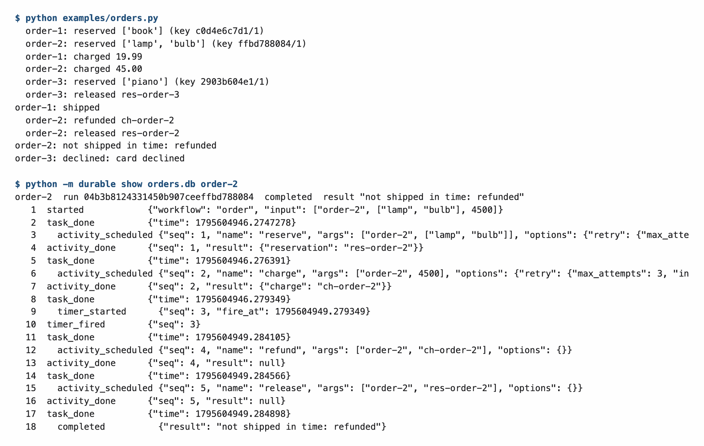
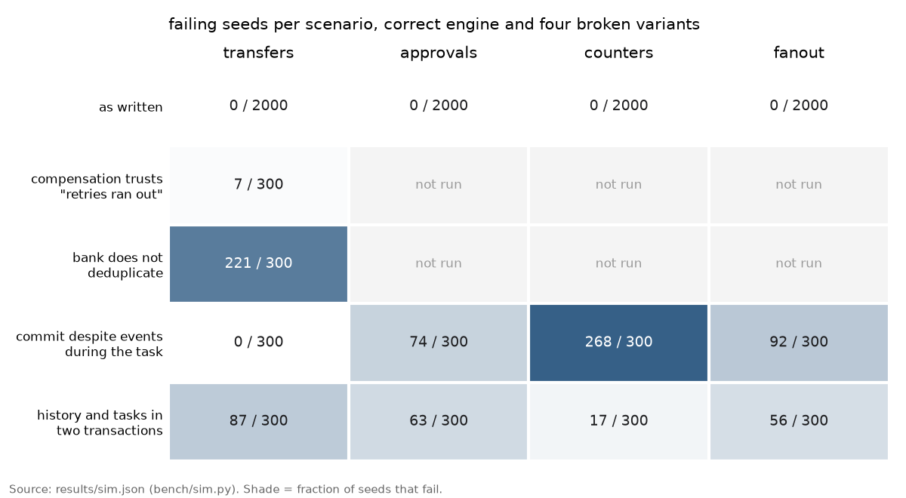
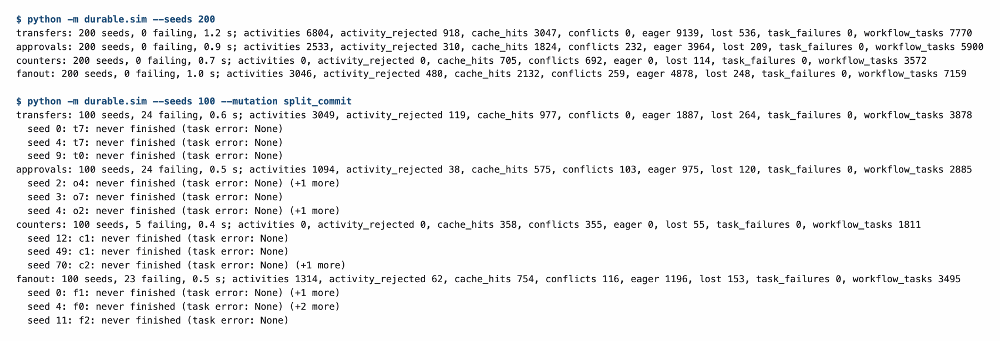
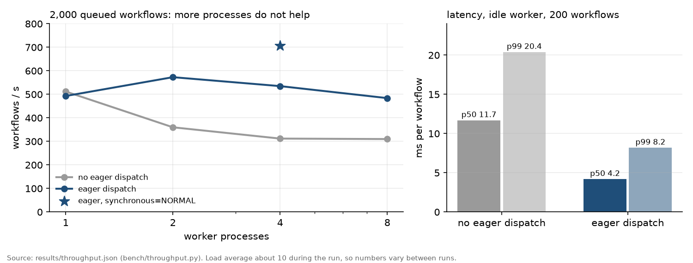
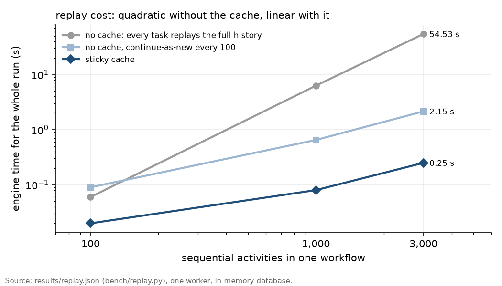

# durable-workflows

A durable execution engine in about 1,300 lines of Python, standard library only. You write a business process as plain async code. The engine records every step in an event history in SQLite and rebuilds the code's state by replaying it. A workflow therefore survives a crash of any process at any line, sleeps for days on a durable timer, and reacts to signals from outside. The model is the one Temporal and Azure Durable Functions are built on.

```python
async def order(ctx, order_id, items, cents):
    res = await ctx.activity(reserve, order_id, items, retry=RetryPolicy(max_attempts=3))
    try:
        ch = await ctx.activity(charge, order_id, cents, retry=RetryPolicy(non_retryable=["ValueError"]))
    except ActivityError as e:
        await ctx.activity(release, order_id, res["reservation"])
        return f"declined: {e.message}"
    which, _ = await ctx.first(ctx.wait_signal("shipped"), ctx.sleep(3 * 86400))
    if which == 1:
        await ctx.activity(refund, order_id, ch["charge"])
        await ctx.activity(release, order_id, res["reservation"])
        return "refunded"
    return "shipped"
```

Running `examples/orders.py` and then printing the history of the order that was never shipped. Every step the code took is an event; replaying these 18 events rebuilds the workflow's state.



What it has:
- **Activities** with retries, exponential backoff, per-attempt timeouts, heartbeats, and an idempotency key per activity.
- **Durable timers and signals**, with `first` and `gather` over them.
- **Child workflows, cancellation, queries and continue-as-new.** Cancellation is thrown into the workflow, so it can run compensations.
- **Determinism checks.** Code that no longer matches a run's history stops that run's progress instead of corrupting it, and `ctx.patched()` changes code under running workflows safely.
- **Eager dispatch and a sticky cache.** The first cuts a three-step workflow from 14 write transactions to 8. With the second, a 3,000-step workflow costs 0.25 s of engine time instead of 54.5 s.

## How it is tested

**Deterministic simulation.** The whole engine runs in one thread on an in-memory database, with every source of non-determinism taken from one seeded random generator, so any failing seed replays exactly. One seed decides:
- which of 3 workers moves next;
- when a worker dies holding a task, or stalls and comes back after its lease expired;
- when a transaction is cut off halfway;
- when an activity call fails before or *after* its side effect;
- when the clock jumps and when signals arrive.

After the faults stop, every workflow must finish. Then the checks run:
- the scenario's invariants (money conserved, every signal counted once, an order shipped if and only if the approval came before the deadline);
- every history must be well formed;
- every run must replay from scratch to exactly its recorded commands.

**Testing the tests.** The checks must fail on the bugs they are meant to catch, so four variants are broken on purpose (`results/sim.json`, `python bench/sim.py`):

| variant | transfers | approvals | counters | fan-out |
|---|---|---|---|---|
| as written | 0 / 2000 | 0 / 2000 | 0 / 2000 | 0 / 2000 |
| compensation trusts "retries ran out" | 7 / 300 | | | |
| the bank does not deduplicate requests | 221 / 300 | | | |
| commit although events arrived during the workflow task | 0 / 300 | 74 / 300 | 268 / 300 | 92 / 300 |
| history and task tables written in two transactions | 87 / 300 | 63 / 300 | 17 / 300 | 56 / 300 |

Failing seeds out of seeds run. Transfers never receive an event during a workflow task, so the third variant cannot show there. One simulated run takes about 10 ms.



*The table above as a grid, drawn from `results/sim.json`.*

A short run of the simulator, first as written and then with the split-commit bug. The broken engine leaves workflows that never finish:



**Two real bugs the simulator found:**
- **My first transfer saga.** It refunded the source when a deposit ran out of retries. But the last attempt can apply the deposit and then lose the reply, so that version created money. Compensation now voids each step by its business key: the bank reverses the step if it was applied, and refuses it if it arrives later.
- **Recorded time.** The engine recorded the time a workflow task *reported* instead of the time its code *ran*. A replay then saw a different `ctx.now()`. It went unnoticed until a deadline computed from `ctx.now()` went into an activity argument; then all 200 approval seeds stopped with a non-determinism error.

**Real processes, real kill -9** (`python -m durable.chaos`). Three worker processes share a SQLite file, and a second SQLite file stands in for the bank. One random worker is SIGKILLed every 50 ms on average and restarted. In the recorded run (`results/chaos.json`), 300 transfers finished through 362 kills in 22 s, and the balances matched the workflow results exactly. The bank refused 55 repeated calls by their keys.

**Unit tests** (`python -m pytest -q`, 32 tests, about 30 s, including a smaller kill -9 run). They cover each feature, plus:
- a run with a code change that stops it until rolled back;
- patched and unpatched histories;
- leases that expire mid-activity;
- signals that arrive while a workflow task is running;
- cached and replayed execution writing identical histories.

## Numbers

Apple M4 Pro, Python 3.12, SQLite 3.50. Other jobs kept the machine busy (load average about 10), so the timings are pessimistic and vary between runs.

**Write transactions per workflow** (three sequential activities): 14 without eager dispatch, 8 with it. Of the engine's time on a file database, 70% is spent inside SQLite, mostly in commits, so this count is what limits throughput.

**Latency** of one such workflow on an idle worker (`bench/throughput.py`, `results/throughput.json`, 200 workflows): p50 11.7 ms and p99 20.4 ms without eager dispatch; p50 4.2 ms and p99 8.2 ms with it.

**Throughput**, 2,000 such workflows queued at once: 310 to 710 workflows/s across configurations and runs. More worker processes never helped. All writes go through SQLite's single write lock, so they wait for each other.



*Throughput and latency from `results/throughput.json`. The star is the one run with `synchronous=NORMAL` instead of `FULL`.*

**Replay** (`bench/replay.py`, `results/replay.json`), a workflow of n sequential activities, one worker, in-memory database:

| activities | history events | one full replay | whole run, no cache | no cache, continue-as-new every 100 | sticky cache |
|---|---|---|---|---|---|
| 100 | 303 | 0.41 ms | 0.06 s | 0.09 s | 0.02 s |
| 1,000 | 3,003 | 4.8 ms | 6.29 s | 0.65 s | 0.08 s |
| 3,000 | 9,003 | 13.9 ms | 54.5 s | 2.15 s | 0.25 s |

Replay costs about 1.5 µs per event. Without the cache every workflow task replays everything, so the total grows with the square of the length.



*Whole-run engine time from `results/replay.json`, log-log. Without the cache the slope is 2.*

The figures are drawn from the files in `results/` by `scripts/make_figures.py`. The two terminal images are real output captured by `scripts/capture_terminal.py`.

## Run it

```bash
python examples/orders.py                  # three orders: shipped, refunded after the deadline, declined
python -m durable show orders.db order-2   # its history
python -m durable.sim --seeds 2000         # the simulator
python -m durable.sim --seeds 300 --mutation split_commit
python -m durable.chaos --transfers 300 --workers 3 --kill-every 0.05
pip install pytest && python -m pytest -q
```

Using it:

```python
from durable import Client, Store, Worker

store = Store("app.db")
Worker(store, workflows=[order], activities=[reserve, charge, refund, release]).run()  # threads
client = Client(store)
client.start(order, "order-7", ["lamp"], 4500, id="order-7")   # idempotent for a given id
client.signal("order-7", "shipped")
client.result("order-7")
```

## Layout

```
durable/
  runtime.py    replay: futures, a FIFO coroutine scheduler, command matching, ctx
  store.py      sqlite: runs, history, activities, timers; leases and commit checks
  worker.py     take / run / report for workflow tasks and activities; eager dispatch, sticky cache
  client.py     start, signal, cancel, query, result
  sim.py        the deterministic simulator and history checks
  scenarios.py  the simulated workloads and their invariants
  chaos.py      the kill -9 run with real processes
examples/orders.py
bench/          sim, replay and throughput benchmarks
scripts/        README figures and terminal captures
docs/how-it-works.md
```

`docs/how-it-works.md` walks through the design:
- the history and replay algorithm;
- why leases alone do not make it safe;
- what "exactly once" can and cannot mean;
- eager dispatch and the sticky cache;
- how the simulator works.

## Limits

- **One SQLite file.** It takes one writer at a time, and adding worker processes does not raise throughput. Scaling out needs row-level locking (Postgres with `SKIP LOCKED`), or shards by workflow id, as Temporal has.
- **Not implemented:**
  - cancelling a running activity, or propagating cancellation to child workflows;
  - schedule-to-start timeouts;
  - search over workflows;
  - versioning by worker build;
  - a UI.
- **Payloads are JSON values.**
- **Any exception that escapes workflow code fails the workflow.** Temporal instead retries the workflow task for unexpected errors, so a bug can be fixed without losing the run.
